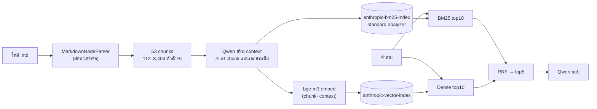
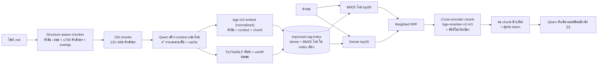

# KDAI-NLP Assignment — Authentic RAG: Baseline vs Improved

งานส่งวิชา **Natural Language Processing (KDAI, สจล.)** หัวข้อ *RAG Theory / Contextual Retrieval* (ครูเอ้, Sep 2026)

| ข้อ | สิ่งที่โจทย์ขอ | อยู่ที่ไหนใน repo |
|---|---|---|
| (1) | สร้างระบบ RAG ตามโค้ดและคำอธิบายสไลด์หน้า 22, 25 | [`baseline/`](baseline/) |
| (2) | ปรับปรุง chunking, embedding, search, scoring, reranking (ไม่เปลี่ยน LLM ตัวตอบ) | [`improved/`](improved/) |
| (3) | อธิบายความต่าง (1) vs (2) ต่างตรงไหน ดีขึ้นอย่างไร เพราะอะไร | [`docs/COMPARISON.md`](docs/COMPARISON.md) + สรุปด้านล่าง |
| (4) | เก็บโค้ด + คำอธิบายลง GitHub | repo นี้ |
| (6) | เตรียมอธิบายให้เพื่อนฟัง | [`docs/PRESENTATION.md`](docs/PRESENTATION.md) |

> LLM ที่ใช้สร้างคำตอบสุดท้าย **เป็นตัวเดียวกันทั้งสองระบบ**: `qwen/qwen-2.5-72b-instruct` ผ่าน OpenRouter
> สิ่งที่ต่างกันทั้งหมดอยู่ที่ "การเตรียมข้อมูลและการค้นคืน" ก่อนถึง LLM

---

## 1. ภาพรวมสองระบบ

### (1) Baseline — Authentic RAG ตามสไลด์



### (2) Improved



## 2. สรุปการปรับปรุง (รายละเอียดเต็มใน [`docs/COMPARISON.md`](docs/COMPARISON.md))

| # | ส่วน | Baseline | Improved | ทำไมดีขึ้น |
|---|---|---|---|---|
| 1 | **Chunking** | `MarkdownNodeParser(chunk_size=256)` — ค่า 256 ไม่มีผล ได้ chunk 112–8,404 ตัวอักษร | ตัดตามหัวข้อ → ย่อหน้า/bullet → ขอบคำไทย, ≤700 ตัวอักษร, overlap 120, ติด breadcrumb, ตัด boilerplate | 1 chunk = 1 เรื่อง → embedding ไม่เจือจาง, ใช้งบ context น้อยลง ~4 เท่า |
| 2 | **Contextual chunk** | prompt ได้ `<document>` = ตัว chunk เอง (bug) และตอบเป็นอังกฤษ | ส่งเอกสารเต็มจริง, สั่งตอบภาษาไทยพร้อมชื่อโรค/หัวข้อ/คำพ้อง, cache ลงไฟล์ | ตรงตามวิธีของ Anthropic; context ภาษาเดียวกับคำถามจึงช่วย BM25 ได้ |
| 3 | **Embedding** | encode ทีละ chunk, ไม่ normalize | batch + normalize, embed "หัวข้อ + context + chunk" | เวกเตอร์รู้ว่าเป็นของโรคไหน หัวข้อไหน |
| 4 | **BM25 ภาษาไทย** | `standard` analyzer → ภาษาไทยทั้งวลีเป็น 1 token | PyThaiNLP `newmm` + แตกคำประสม + stopword, ค้นหลาย field แบบ `most_fields` | BM25 กลับมาใช้งานได้จริงกับภาษาไทย (Recall@5 4% → 88% ในการทดลอง offline) |
| 5 | **Fusion / scoring** | RRF น้ำหนักเท่ากัน, pool 10+10 | Weighted RRF, pool 30+30, ปรับน้ำหนักได้ | pool ใหญ่ให้ reranker มีของให้เลือก |
| 6 | **Reranking** | ไม่มี (ทั้งที่สไลด์หน้า 17, 19 ระบุว่าเป็นขั้นที่ 2) | Cross-encoder `BAAI/bge-reranker-v2-m3` + threshold ตัดที่ไม่เกี่ยวข้อง | แก้ข้อจำกัด "ขาดการวัด relevance" ในสไลด์หน้า 14 |
| 7 | **Context assembly** | ตัดความยาวด้วย `split()` (ภาษาไทยไม่มีช่องว่าง → นับผิด) | นับ token จริง, ต่อ chunk ข้างเคียง, ลบ overlap ซ้ำ, ใส่เลขอ้างอิง | LLM ได้ข้อมูลครบและตรวจย้อนแหล่งที่มาได้ |
| 8 | **Storage** | 2 index แยกกัน; vector index ไม่เก็บ context → hit จาก dense ไม่มี context ส่งให้ LLM | 1 index มีทั้ง dense + sparse + context | ทุก hit มี context เสมอ, id ตรงกัน ไม่มีปัญหา index ไม่ sync |
| 9 | **การวัดผล** | ไม่มี | eval set 24 ข้อ + Recall@k / MRR / Failed@k / Recall@งบตัวอักษร | พิสูจน์ได้ด้วยตัวเลข ไม่ใช่ความรู้สึก |

## 3. ผลการทดลอง

### 3.0 หลักฐานจากผลลัพธ์ของ baseline เอง

ในไฟล์ผลลัพธ์ตัวอย่างจาก repo ของครู ([`results/baseline_reference_output_from_instructor_repo.json`](results/baseline_reference_output_from_instructor_repo.json)):
คะแนน RRF ของ top-5 คือ 1/60, 1/61, 1/62, 1/63, 1/64 พอดี (= มาจาก ranker ตัวเดียว ไม่มี chunk ใดถูกเจอโดยทั้ง BM25 และ dense),
field `context` ว่าง **25/25** ผลลัพธ์ และคำตอบอ้างข้อมูลที่ไม่มีใน corpus — รายละเอียดใน [`docs/COMPARISON.md` §0](docs/COMPARISON.md#0-หลักฐานจากผลลัพธ์ของ-baseline-เอง)

### 3.1 Offline (รันได้ทันที ไม่ต้องมี OpenSearch / GPU / API key) — ผลจริงจาก `python eval/offline_bm25_study.py`

ทดลองเฉพาะ **BM25** แบบ 2×2 เพื่อแยกผลของ "วิธี chunking" กับ "วิธีตัดคำ" ออกจากกัน (สูตร BM25 เดียวกับ Lucene, k1=1.2, b=0.75):

| ระบบ | Recall@1 | Recall@5 | Recall@20 | MRR@10 | Recall@1,500 ตัวอักษร | Recall@3,000 ตัวอักษร | ตัวอักษรใน top-5 |
|---|---|---|---|---|---|---|---|
| A: baseline chunks + standard analyzer (= baseline) | 4.2% | 4.2% | 4.2% | 0.042 | 4.2% | 4.2% | 95 |
| B: baseline chunks + PyThaiNLP | 54.2% | 100.0% | 100.0% | 0.717 | 41.7% | 62.5% | 11,155 |
| D: improved chunks + PyThaiNLP | 58.3% | 79.2% | 91.7% | 0.666 | 70.8% | 79.2% | 2,609 |
| **E: improved chunks + PyThaiNLP + decompound** (= improved) | 54.2% | 87.5% | **100.0%** | 0.651 | 70.8% | **87.5%** | **2,643** |

อ่านผลอย่างไร
- **ตัวการใหญ่ที่สุดคือการตัดคำไทย** (A → B): BM25 ของ baseline แทบไม่เคยเจอเอกสารที่ถูก เพราะ query ภาษาไทยทั้งวลีกลายเป็น token เดียว ข้อเดียวที่เจอ (q07) เพราะในคำถามมีคำภาษาอังกฤษ "MMR"
- **Recall@k หลอกได้เมื่อ chunk ใหญ่**: B ได้ Recall@5 = 100% แต่ top-5 ยาว 11,155 ตัวอักษร (~1/5 ของทั้ง corpus) เมื่อจำกัดงบ context ให้เท่ากัน (คอลัมน์ "@3,000 ตัวอักษร") chunk เล็กชนะชัด 87.5% vs 62.5% เพราะส่วนที่ตอบคำถามไม่ถูกกลบด้วยเนื้อหาเรื่องอื่น
- ผลรายคำถามดูได้ที่ [`results/offline_bm25_study.md`](results/offline_bm25_study.md)

### 3.2 ระบบจริงบน OpenSearch — ผลจริงจาก `python eval/evaluate_retrieval.py`

รันบน MacBook Air (OpenSearch 2.19.1, bge-m3, bge-reranker-v2-m3) คำถาม 24 ข้อใน `eval/eval_set.json`
**รอบนี้ระบบ improved ปิดการสร้าง context (`USE_CONTEXT=0`)** — เป็น ablation ที่วัดผลของ chunking + BM25 ไทย + fusion + rerank ล้วน ๆ
(ไฟล์ผลเต็ม: [`results/retrieval_eval_noctx.md`](results/retrieval_eval_noctx.md))

| ระบบ | Recall@1 | Recall@5 | Recall@20 | MRR@10 | Recall@1,500 ตัวอักษร | Recall@3,000 ตัวอักษร | ตัวอักษรใน top-5 |
|---|---|---|---|---|---|---|---|
| Baseline · BM25 (standard analyzer) | 4.2% | 4.2% | 4.2% | 0.042 | 4.2% | 4.2% | 95 |
| Baseline · Dense | 91.7% | 91.7% | 100.0% | 0.924 | 75.0% | 83.3% | 11,093 |
| **Baseline · Hybrid RRF (สไลด์หน้า 25)** | 91.7% | 91.7% | 100.0% | 0.924 | 75.0% | 83.3% | 11,093 |
| Improved · BM25 ไทย (PyThaiNLP) | 50.0% | 83.3% | 95.8% | 0.640 | 70.8% | 83.3% | 2,621 |
| Improved · Dense | 87.5% | **100.0%** | 100.0% | 0.931 | **100.0%** | **100.0%** | 2,663 |
| Improved · Hybrid Weighted-RRF | 66.7% | 91.7% | 100.0% | 0.796 | 91.7% | 95.8% | 2,711 |
| **Improved · Hybrid + Rerank (ระบบเต็ม)** | **95.8%** | 95.8% | 100.0% | **0.965** | 95.8% | **100.0%** | 2,759 |

อ่านผล
1. **Baseline Hybrid = Baseline Dense ทุกตัวเลข** → BM25 ของ baseline (4.2%) ไม่ได้ช่วยอะไรใน fusion เลย ยืนยันหลักฐาน §3.0
2. **BM25 ไทยใช้งานได้จริง**: Recall@5 4.2% → 83.3%
3. **ส่ง context ให้ LLM น้อยลง ~4 เท่า (11,093 → 2,759 ตัวอักษร) แต่หาคำตอบเจอมากขึ้น** เมื่อคุมงบเท่ากัน 1,500 ตัวอักษร: 75.0% → 95.8%
4. **Hybrid แบบ RRF น้ำหนักเท่ากัน ทำให้แย่ลงได้** (Recall@1 87.5% → 66.7%) เพราะ BM25 ยังอ่อนกว่า dense chunk ที่ BM25 จัดผิดจึงถูกดันขึ้นมา — **reranker แก้ได้** (→ 95.8%, MRR สูงสุด 0.965) เช่น q22 อันดับ 9 → 1
5. ตัวอย่างรายคำถามที่ดีขึ้นชัด: q05 "จะแยกโรคหัดออกจากหัดเยอรมันได้อย่างไร" baseline อันดับ 11 → improved อันดับ 1, q16 อันดับ 6 → 1
6. **ข้อที่ยังพลาด: q01** "ติดหัดเยอรมันช่วง*ตั้งท้องสามเดือนแรก*" ระบบเต็มได้อันดับ 6 (หลุด top-5) ขณะที่ baseline ได้อันดับ 1 เพราะ chunk ของ baseline ทั้งหัวข้อหญิงตั้งครรภ์อยู่ก้อนเดียว ส่วนเอกสารใช้คำว่า "*ไตรมาสแรกของการตั้งครรภ์*" ซึ่งต่างจากคำถามทั้งคำ ("ตั้งท้อง" vs "ตั้งครรภ์", "สามเดือนแรก" vs "ไตรมาสแรก") — เป็นกรณีที่ contextual chunk (คำพ้องใน context) ออกแบบมาแก้

> ข้อจำกัด: คำถาม 24 ข้อ ต่างกัน 1 ข้อ = 4.2% ตัวเลขควรอ่านเป็นแนวโน้ม

### 3.3 Contextual Retrieval เต็มรูปแบบ (`USE_CONTEXT=1`)

โค้ดพร้อมแล้ว (`improved/contextualizer.py`) ทดสอบสร้าง context ไปได้ 11/154 chunks ก่อนเครดิต OpenRouter หมด
รันต่อได้ด้วย `python -m improved.ingest` (ทำต่อจาก cache) แล้ว `python eval/evaluate_retrieval.py` เพื่อเทียบกับตาราง 3.2

<!-- เมื่อรันแบบมี context แล้ว วางตารางผลตรงนี้ -->

## 4. วิธีรัน

### 4.1 เตรียมระบบ (ครั้งเดียว)

```bash
git clone https://github.com/68056097/kdai-nlp-rag-assignment.git
cd kdai-nlp-rag-assignment

conda create -n advrag python=3.10 -y && conda activate advrag
pip install -r requirements.txt

docker compose up -d                       # OpenSearch 2.19.1 ที่ localhost:9200
curl localhost:9200                         # ต้องเห็น JSON ของ OpenSearch

export OPENROUTER_API_KEY='sk-or-...'       # Windows (cmd): set OPENROUTER_API_KEY=sk-or-...
```

> ครั้งแรกจะดาวน์โหลดโมเดลจาก HuggingFace: `BAAI/bge-m3` (~2.3 GB) และ `BAAI/bge-reranker-v2-m3` (~2.3 GB)

### 4.2 (1) Baseline — ตามสไลด์หน้า 22 และ 25

```bash
python baseline/authenticRAG.py             # Hands-on 1: นำเข้าเอกสาร → anthropic-*-index
python baseline/onlysearchAuthenticRAG.py   # Hands-on 2: ถาม 5 ข้อ → authentic_rag_search_results.json
```

แก้จากต้นฉบับของครูเพียง 2 จุด (ไม่กระทบ logic): import `Document` ให้รองรับ langchain รุ่นใหม่ (แทนการ `pip install "langchain<0.1"` ตามหมายเหตุหน้า 22) และเปิดไฟล์ด้วย UTF-8

**ข้อแตกต่างจาก [readme.md ของอาจารย์](https://github.com/aekanun2020/2025-authenticRAG/blob/main/readme.md)** (ลิงก์ในสไลด์หน้า 22, 25) — ไม่มีจุดใดกระทบผล
ยืนยันได้จากคะแนน RRF ที่รันได้ (0.0167, 0.0164, 0.0161, 0.0159, 0.0156) ตรงกับไฟล์ผลตัวอย่างใน repo ของอาจารย์ทุกตัว

| readme.md ของอาจารย์ | repo นี้ | เหตุผล |
|---|---|---|
| `pip install` ทีละแพ็กเกจ | `pip install -r requirements.txt` | แพ็กเกจหลักชุดเดียวกัน รวมไว้ในไฟล์เดียว |
| `docker run ... opensearch:2.19.1` | `docker compose up -d` | image และค่าตั้งเดียวกัน (2.19.1, ปิด security, พอร์ต 9200) |
| ติดตั้ง Ollama + `ollama pull bge-m3` | ไม่ได้ติดตั้ง | โค้ดของอาจารย์โหลด `BAAI/bge-m3` จาก HuggingFace ผ่าน `SentenceTransformer` ไม่ได้เรียก Ollama |
| ถ้าเจอ `No module named 'langchain.schema'` ให้ลง `langchain<0.1` (สไลด์หน้า 22) | แก้บรรทัด import ใน `authenticRAG.py` แทน (ป้าย `[แก้เพิ่ม]`) | แก้ปัญหาเดียวกัน ใช้ langchain รุ่นปัจจุบันได้ |

### 4.3 (2) Improved

```bash
python -m improved.ingest                   # นำเข้า → improved-rag-index  (+ cache/contexts.json, cache/chunks.json)
python -m improved.ask                      # ชุดคำถามเดียวกับ baseline → results/improved_answers.json
python -m improved.ask -q "อาการของต้อกระจกเป็นอย่างไร"
```

### 4.4 วัดผลและเปรียบเทียบ

```bash
pytest -q                                   # unit tests (ไม่ต้องมี OpenSearch)
python eval/offline_bm25_study.py           # ทดลอง chunking × tokenizer แบบ offline
python eval/evaluate_retrieval.py           # retrieval eval ของทั้งสองระบบบน OpenSearch
python eval/compare_answers.py              # คำตอบเคียงข้างกัน (เรียก LLM)
```

### 4.5 Ablation — ปิด/เปิดทีละเทคนิคผ่าน environment variable

```bash
USE_RERANK=0 python eval/evaluate_retrieval.py                 # ไม่ rerank
USE_CONTEXT=0 RAG_INDEX=improved-noctx python -m improved.ingest  # ไม่สร้าง context
WEIGHT_SPARSE=0.5 python eval/evaluate_retrieval.py            # ลดน้ำหนัก BM25 ใน RRF
CHUNK_MAX_CHARS=1000 python -m improved.ingest                  # ลองขนาด chunk อื่น
```

ค่าที่ปรับได้ทั้งหมดอยู่ใน [`improved/config.py`](improved/config.py) และ [`.env.example`](.env.example)

## 5. โครงสร้าง repo

```
├── baseline/                    (1) โค้ดตามสไลด์หน้า 22, 25
│   ├── authenticRAG.py              Hands-on 1: นำเข้าเอกสาร
│   └── onlysearchAuthenticRAG.py    Hands-on 2: ค้น วิเคราะห์ สรุปคำตอบ
├── improved/                    (2) ระบบที่ปรับปรุง
│   ├── config.py                    ทุกค่าที่ปรับได้ (ablation)
│   ├── chunking.py                  structure-aware chunking ภาษาไทย
│   ├── contextualizer.py            Contextual Retrieval (เอกสารเต็ม + cache)
│   ├── thai_text.py                 ตัดคำไทยสำหรับ BM25 + แตกคำประสม
│   ├── models.py                    bge-m3 embedder, bge-reranker-v2-m3
│   ├── store.py                     OpenSearch index เดียว (dense + BM25 ไทย)
│   ├── fusion.py                    Weighted RRF, merge overlap
│   ├── pipeline.py                  ประกอบทุกขั้น: ingest / retrieve / build_context / answer
│   ├── llm.py                       Qwen client (ตัวเดียวกับ baseline)
│   ├── ingest.py, ask.py            CLI
├── eval/
│   ├── eval_set.json                24 คำถาม + gold phrase ที่ตรวจแล้วว่ามีอยู่ในเอกสาร
│   ├── metrics.py                   Recall@k, MRR, Failed@k, Recall@งบตัวอักษร
│   ├── offline_bm25_study.py        ทดลอง offline
│   ├── evaluate_retrieval.py        วัดผลระบบจริงทั้งสอง
│   └── compare_answers.py           เทียบคำตอบสุดท้าย
├── tests/test_offline.py        unit tests
├── docs/COMPARISON.md           (3) อธิบายความแตกต่างอย่างละเอียด
├── docs/PRESENTATION.md         (6) โน้ตสำหรับนำเสนอในห้อง
├── results/                     ผลการทดลอง
├── corpus_input/                เอกสาร 4 ไฟล์ (หัดเยอรมัน, อหิวาตกโรค, ต้อกระจก, กรดไหลย้อน)
└── docker-compose.yml           OpenSearch 2.19.1
```

## 6. อ้างอิง

- Anthropic, *Introducing Contextual Retrieval* — https://www.anthropic.com/engineering/contextual-retrieval
- ครูเอ้ (Aekanun Thongtae), *2025-authenticRAG* — https://github.com/aekanun2020/2025-authenticRAG
- Chip Huyen, *AI Engineering*, O'Reilly, 2024 (บทที่ 6 RAG)
- Cormack et al., *Reciprocal Rank Fusion outperforms Condorcet and individual Rank Learning Methods*, SIGIR 2009
- Chen et al., *BGE M3-Embedding*, 2024 · BAAI, *bge-reranker-v2-m3*
- PyThaiNLP — https://github.com/PyThaiNLP/pythainlp
- เอกสารใน `corpus_input/` มาจาก repo ของครู (ต้นฉบับจาก medthai.com) ใช้เพื่อการศึกษาเท่านั้น
